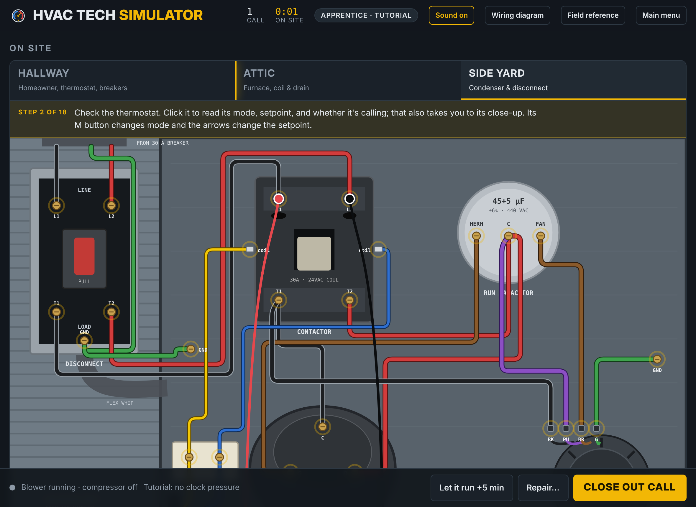

<p align="center">
  
</p>

<p align="center">
  <b>Run the service call. Find the fault. Fix it right.</b><br>
  A residential HVAC troubleshooting simulator: play it at <a href="https://hvactechsimulator.com">hvactechsimulator.com</a>
</p>

<p align="center">
  
</p>

## What it is

HVAC Tech Simulator puts you on residential service calls. Talk to the homeowner, test the equipment, find the fault, make the repair, then verify the system before you close out the call. Every call is timed and scored.

**Equipment**
- Split A/C: condenser, attic air handler, refrigerant circuit
- Gas furnace: full sequence of operation, from the call through ignition and flame proving
- Hydronic boiler: zone thermostats, zone valves, circulator, and system pressure

**Field skills**
- Trace any wire end to end, or light up everything joined to it
- Meter any terminal: volts, ohms, microfarads, and flame-sensor microamps
- Clamp any wire for amps, compared against the nameplate
- Lift wires to isolate a part, and clip test jumpers across 24 V terminals
- Read refrigerant gauges, superheat and subcooling, temperature split and rise, and gas pressure
- Follow lockouts, safety switches, and real fault codes

**Modes**
- Guided tutorials for A/C, furnace, and boiler
- Easy and hard calls with red herrings
- Apprentice tips on or off, plus summer and winter seasons

## Running it

The whole game is one file, `index.html`, with no build step and no server code. Open it in any modern browser, or serve the folder with any static host.

## Hosting

This repository is set up for GitHub Pages with the custom domain `hvactechsimulator.com`:
- `CNAME` points Pages at the domain.
- `404.html` is the not-found page.
- `site.webmanifest`, the icons, and `assets/og-image.png` give it a home-screen icon and a link preview.

## Files

```
index.html            the game
404.html              not-found page
favicon.ico/.svg      browser icons
site.webmanifest      home-screen app info
robots.txt, sitemap.xml
assets/               logo, icons, social preview image
docs/screenshot.png   README image
```

## Copyright

© 2026 HVAC to the Future. All rights reserved. See [LICENSE](LICENSE).
